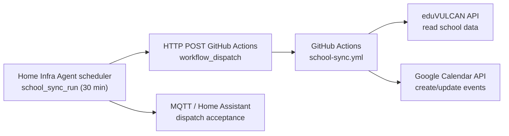

# eduVULCAN → Google Calendar automation

This is the operational runbook for the private school-calendar sync in **Home Infra Agent**. The home-lab agent dispatches a GitHub Actions workflow every **30 minutes**; the workflow fetches eduVULCAN data and applies relevant changes to a dedicated Google Calendar. This is not a calendar-to-calendar subscription and does not require a continuously running local sync process.

## Architecture and ownership



| Responsibility | Implementation |
| --- | --- |
| Job schedule / MQTT device | [`config/jobs/school_sync_run/job.yaml`](../config/jobs/school_sync_run/job.yaml) |
| Dispatch request | [`config/jobs/school_sync_run/trigger.yaml`](../config/jobs/school_sync_run/trigger.yaml) |
| GitHub workflow | [`.github/workflows/school-sync.yml`](../.github/workflows/school-sync.yml) |
| Sync logic | [`scripts/school_calendar_sync.py`](../scripts/school_calendar_sync.py) |
| Python dependencies | [`scripts/school-sync-requirements.txt`](../scripts/school-sync-requirements.txt) |
| Tests | [`tests/test_school_calendar_sync.py`](../tests/test_school_calendar_sync.py) |

The agent sends `POST https://api.github.com/repos/spider-su/ha-infra-agent/actions/workflows/school-sync.yml/dispatches` with `{"ref":"main"}`. A **204** response means GitHub accepted the dispatch; it does **not** mean the synchronization completed successfully. The workflow's default manual/dispatch input is `dry_run=false`, so the 30-minute job performs **live writes**. The workflow uses a concurrency group to avoid overlapping runs.

The agent publishes its result at MQTT topic `home/school_sync_run/state` and exposes a Home Assistant binary sensor **School sync trigger accepted** (`reachable`). This monitors the dispatch request, **not** the final GitHub Actions outcome. Review Actions runs for end-to-end success; there is currently no automatic workflow-completion feedback into the agent.

## What is synchronized

- **Exams** (`Sprawdzian`): all-day events, with a popup reminder 24 hours beforehand.
- **Homework** (`Zadanie domowe`): all-day events.
- **Changed/substituted lessons** (`Zastępstwo`): timed events where an eduVULCAN `Substitution` object is present.
- **Cancelled lessons** (`Odwołane`): timed events inferred from substitution data.
- **Ordinary timetable lessons are intentionally excluded.**

Dates are interpreted in `Europe/Warsaw`. By default, each run queries **7 days back** and **60 days ahead**. Items with missing IDs or unparseable dates/times are skipped.

Events have deterministic Google Calendar IDs derived from pupil, source type, and eduVULCAN record ID (plus date for changed lessons). Existing events are compared and patched only when relevant fields change; repeated identical runs should create **no duplicates**. **Deletions are disabled:** if an item disappears from eduVULCAN or leaves the query window, its previously created Google event remains. Cancellation classification is heuristic and should be checked against actual school records. Do not manually repurpose sync-created events, as future runs may overwrite synced fields.

## Credentials and configuration

### 1. Home Infra Agent runtime (Kubernetes)

The dispatch task reads **`GITHUB_ACTIONS_TRIGGER_TOKEN`** from the agent's runtime environment via `tokenEnv` in `trigger.yaml`. Supply a GitHub token authorized to dispatch `school-sync.yml` in `spider-su/ha-infra-agent` through the deployment's secret-management mechanism, then restart/redeploy the agent if the secret changes.

This token is **not** a GitHub Actions repository secret. Do not place token values in YAML, commits, or logs.

### 2. GitHub Actions secrets and variable

Go to [repository Actions secrets and variables](https://github.com/spider-su/ha-infra-agent/settings/secrets/actions).

| Name | Type | Purpose |
| --- | --- | --- |
| `VULCAN_CREDENTIAL_JSON` | Secret | Entire registered-device JSON from the `vulcan-client` registration, not the initial registration token |
| `GOOGLE_OAUTH_JSON` | Secret | **Authorized-user JSON** with `refresh_token`, `client_id`, `client_secret`, and `token_uri` |
| `GOOGLE_CALENDAR_ID` | Secret | ID of the dedicated writable destination calendar |
| `VULCAN_PUPIL_INDEX` | Optional repository **variable** | Zero-based pupil/account index, defaults to `0` |

Check names and update times safely with:

```bash
gh secret list --repo spider-su/ha-infra-agent
gh variable list --repo spider-su/ha-infra-agent
```

Never print or paste the secret JSON. The downloaded Google OAuth **Desktop client JSON** (top-level `installed` object) is **not** a valid `GOOGLE_OAUTH_JSON` secret by itself: it must first be authorized to produce a refresh token. The Google account used must have write access to the destination calendar. The OAuth scope used by the script is `https://www.googleapis.com/auth/calendar.events`.

### 3. Google Cloud OAuth settings

The current OAuth configuration uses Google Cloud project **`booksearch-221411`**, which contains an **eduVULCAN Desktop** client and an **investory Web** client. Publishing status is a **project-level** setting and therefore affects both.

- [OAuth clients](https://console.cloud.google.com/auth/clients?project=booksearch-221411)
- [Audience](https://console.cloud.google.com/auth/audience?project=booksearch-221411)
- [Branding](https://console.cloud.google.com/auth/branding?project=booksearch-221411)
- [Google Calendar API](https://console.cloud.google.com/apis/library/calendar-json.googleapis.com?project=booksearch-221411)

As of **2026-11-21**, the project was switched from **External / Testing** to **In production** to remove the automatic seven-day Testing-mode refresh-token expiry for newly issued tokens. The console may still display **“Your app requires verification.”** Production does not itself mean Google has verified the app; unverified-app restrictions can still apply. Review Google OAuth policies before expanding access beyond personal use. Refresh tokens can still be revoked or expire for other reasons. Keep Branding homepage/privacy-policy URLs accurate for the apps using this project.

## Initial rollout and manual verification

1. Confirm all secrets are configured, the Google account has access to the intended calendar, and the **dedicated destination calendar** is selected. The 30-minute agent schedule can trigger live writes as soon as secrets are present; temporarily disable the job if you need a controlled initial rollout.
2. Open [School Calendar Sync — GitHub Actions](https://github.com/spider-su/ha-infra-agent/actions/workflows/school-sync.yml). Select `main` → **Run workflow** → `dry_run=true`. Dry-run reads and normalizes eduVULCAN data but **does not call Google Calendar** or validate Google OAuth access.
3. Review the workflow summary's `prepared` count and inspect school records / calendar expectations.
4. Run `dry_run=false` to verify Google authentication and create/update the target events.
5. Repeat `dry_run=false` without school changes. Expected `created=0`, `updated=0`, `unchanged=prepared`. If records changed in the meantime, counts can differ.
6. Confirm subsequent dispatches in Home Assistant/MQTT **and** their completed status in the GitHub Actions run history.

**First production verification (2026-11-21):** `prepared=20, created=20, updated=0, unchanged=0`. A subsequent live run reported `prepared=20, created=0, updated=0, unchanged=20`, confirming idempotency with the existing data. The workflow also successfully ran with `actions/checkout@v6`, `actions/setup-python@v6`, and Python 3.12. These are historical observations, not a promise about future school data.

## Rotating Google OAuth authorization (WSL)

Do this if the token is revoked, expires, permissions change, or you deliberately want a fresh token after switching to Production. Keep the last working GitHub secret until a valid replacement has been generated.

1. Download the **Desktop** OAuth client JSON for the existing **eduVULCAN** client (not the Investory Web client) to your local private working directory as `google_client_secret.json`.
2. In WSL, use a virtual environment (Ubuntu's system Python may be externally managed):

   ```bash
   cd ~/projects/eduvulcan_calendar_package
   python3 -m venv .venv            # if one does not exist
   source .venv/bin/activate
   python -m pip install google-auth-oauthlib
   ```

3. Run your local `authorize_google.py` script using the scope `https://www.googleapis.com/auth/calendar.events`, offline access, and `prompt="consent"`. If it uses `open_browser=False`, copy the printed authorization URL into a Windows browser and complete the localhost redirect. The browser message **“The authentication flow has completed”** indicates the local callback finished.
4. Check that the generated **authorized-user** `google_oauth.json` contains the required fields without printing them:

   ```bash
   python - <<'PY'
   import json
   with open("google_oauth.json", encoding="utf-8") as f:
       d = json.load(f)
   for k in ("refresh_token", "client_id", "client_secret", "token_uri"):
       print(k, "OK" if d.get(k) else "MISSING")
   PY
   ```

5. Only after all fields are present, replace the secret and run a **live** Actions sync to verify the Google API connection:

   ```bash
   gh secret set GOOGLE_OAUTH_JSON --repo spider-su/ha-infra-agent < google_oauth.json
   ```

Keep `google_client_secret.json`, `google_oauth.json`, and local backups outside Git, or add their paths to a local ignore file. Never commit, attach to issues, or paste token contents. If Google returns an intermittent 500 during consent, retry once; don't overwrite the last working secret unless authorization finishes and the token file validates.

## Operations and troubleshooting

| Symptom | Check / recovery |
| --- | --- |
| Home Assistant dispatch sensor is false / job ERROR | Agent logs, GitHub dispatch API availability, `GITHUB_ACTIONS_TRIGGER_TOKEN` runtime injection/permissions, connectivity, and HTTP status |
| Agent reports `reachable=true` but no calendar update | 204 only means the dispatch was accepted; inspect the **GitHub Actions run** to see whether it actually ran and succeeded |
| No Actions runs | Confirm agent pod and schedule, dispatched workflow path, `main` ref, and workflow dispatch token permissions |
| Missing secret / `refresh_token` error | Check GitHub Actions secret names and the **authorized-user** JSON shape; never upload raw Desktop client JSON as the authorized-user secret |
| Google `invalid_grant` / token revoked | Re-authorize the Desktop client, replace the Actions secret, and run a live verification |
| Google Calendar 403 / access denied | Confirm the authorized Google account, Calendar API enablement, OAuth scope, Google app restrictions, and write access to the target calendar |
| Unexpected `prepared=0` | Check `VULCAN_PUPIL_INDEX`, registered eduVULCAN device, date window, and source data before taking any action |
| Events missing from calendar | Check destination calendar selection/visibility, query window, unsupported normal lessons, and whether source items contain required IDs/dates |
| Duplicate or repeatedly updated events | Review deterministic IDs and normalization; compare `created`, `updated`, `unchanged` over consecutive live runs |
| Old events remain after deletion from source | Expected: this integration **never deletes** previously synchronized Google Calendar events |
| Google verification warning | `In production` and **verified** are different states; check [Audience](https://console.cloud.google.com/auth/audience?project=booksearch-221411) and relevant Google policies |

Workflow failures are visible in GitHub Actions; **automatic failure notifications / end-to-end MQTT success telemetry are not implemented**. Avoid treating a successful dispatch as proof that calendar contents are fresh.

## Security and maintenance

- Treat eduVULCAN device credentials, OAuth refresh tokens, calendar IDs, and school records as private. Use secret stores, least-privilege GitHub workflow permissions, and the private agent deployment environment.
- The workflow writes only aggregate counts to its job summary. Do not add raw pupil or school records to logs.
- The Google OAuth project is shared with Investory: changing project-wide Branding, Audience, or consent settings may affect both clients.
- Changes to supported event types, deletion policy, source IDs, or reminder behavior require deliberate testing. For code changes run `python -m pytest -q tests/test_school_calendar_sync.py` and verify manual dry-run followed by live idempotency.
